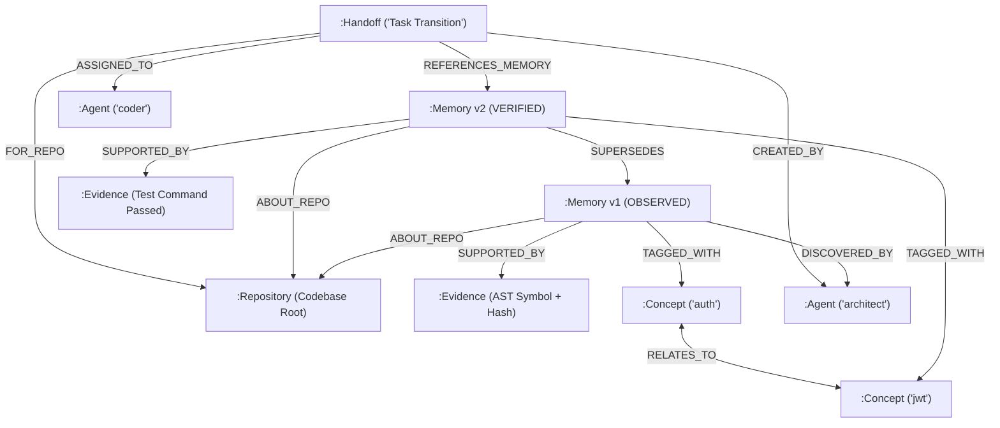

# CodeMem: Local-First Evidence-Backed Shared Memory for Coding Agents

[](https://opensource.org/licenses/MIT)
[](https://www.python.org/)
[](https://wemakedevs.org)
[](https://www.falkordb.com/)

**WeMakeDevs × FalkorDB Hackathon Submission**  
**Track:** Track 2 — Agent Memory and Coordination  
**Authors:** Aryan Gopinathan ([@Aryan7098](https://github.com/Aryan7098)) & Team  
**Repository:** [https://github.com/Aryan7098/codemem](https://github.com/Aryan7098/codemem)  
**Demo Video:** *[Link to Demo Video]* *(Upload demo URL here)*

---

## 1. Executive Summary

Autonomous coding agents (e.g. in Antigravity, Claude Desktop, Cursor, or multi-agent pipelines) suffer from a critical limitation: **statelessness across sessions and loss of shared context across agents**. 

When an agent finishes a task or a new agent takes over, architectural assumptions, bug root causes, and testing decisions are lost. Conventional vector retrieval suffers from silent drift, stale hallucinations, and lack of temporal lineage.

**CodeMem** is a local-first, evidence-backed, change-aware shared memory layer for coding agents powered by **FalkorDB**. It anchors agent beliefs directly to concrete codebase evidence (AST symbols, file content hashes, and passing test runs), tracks belief provenance through openCypher graph relationships, detects when code changes invalidate memories, and enables seamless multi-agent task handoffs.

---

## 2. Why FalkorDB is Essential (Not Just Decoration)

CodeMem cannot function on top of a flat relational table or standard key-value vector store. It fundamentally depends on **openCypher graph queries and multi-hop graph algorithms** executed natively in FalkorDB:

1. **Multi-Hop Concept Expansion (`(:Concept)-[:RELATES_TO*1..2]-(:Concept)`):**  
   When an agent queries for `login`, FalkorDB traverses bidirectional semantic aliases to uncover memories tagged with `auth`, `jwt`, `session`, and `token` without slow embedding rerankers.
2. **Temporal Provenance & Version Chains (`(:Memory)-[:SUPERSEDES*]->(:Memory)`):**  
   CodeMem preserves full chronological lineage. When architecture evolves, new claims supersede older claims via direct graph edges without destroying the audit trail.
3. **Stale Blast Radius Analysis (`(:Memory)-[:SUPPORTED_BY]->(:Evidence)`):**  
   When Git detects a file modification or commit update, Cypher queries immediately traverse evidence edges to identify and flag all affected memories as `STALE`.
4. **Conflict Detection & Resolution (`(:Memory)-[:CONTRADICTS]->(:Memory)`):**  
   Detects contradictory claims asserted by concurrent agents and enforces explicit supersession or conservative abstention.
5. **First-Class Multi-Agent Handoffs (`(:Handoff)-[:REFERENCES_MEMORY]->(:Memory)`):**  
   Connects agent handoff contracts to exact memory nodes, preserving completed work, open risks, and known traps across agent handoffs.

---

## 3. Graph Data Model

### Node Labels
- `:Repository` — Canonical repository scope (`repository_id`, `root_path`, `head_commit`, `remote_url`).
- `:Memory` — Atomic memory claim (`id`, `logical_fact_id`, `claim`, `status`, `confidence_score`, `recorded_at`).
- `:Evidence` — Grounding codebase anchor (`id`, `file_path`, `symbol`, `content_hash`, `test_command`, `test_passed`).
- `:Concept` — Semantic tags and domain entities (`name`).
- `:Agent` — Discovered by or assigned agent persona (`id`).
- `:Session` — Coding session scope (`id`).
- `:Handoff` — Multi-agent handoff record (`handoff_id`, `task_objective`, `completed_work`, `open_risks`, `status`).

### Graph Relationships
```
(:Memory)-[:ABOUT_REPO]->(:Repository)
(:Memory)-[:SUPPORTED_BY]->(:Evidence)
(:Memory)-[:SUPERSEDES {reason, at}]->(:Memory)
(:Memory)-[:CONTRADICTS]->(:Memory)
(:Memory)-[:TAGGED_WITH]->(:Concept)
(:Concept)-[:RELATES_TO]->(:Concept)
(:Memory)-[:DISCOVERED_BY]->(:Agent)
(:Memory)-[:RECORDED_IN]->(:Session)
(:Handoff)-[:FOR_REPO]->(:Repository)
(:Handoff)-[:CREATED_BY]->(:Agent)
(:Handoff)-[:ASSIGNED_TO]->(:Agent)
(:Handoff)-[:REFERENCES_MEMORY]->(:Memory)
```

### Graph Architecture Diagram (Mermaid)



---

## 4. Primary openCypher Queries

Below are the core Cypher queries that drive CodeMem's engine in `src/codemem/graph/adapter.py`:

### 4.1 Concept Graph Traversal (Multi-Hop Semantic Expansion)
```cypher
MATCH (c:Concept)
WHERE toLower(c.name) IN $concepts
OPTIONAL MATCH (c)-[:RELATES_TO*1..2]-(related:Concept)
WITH collect(DISTINCT toLower(c.name)) + collect(DISTINCT toLower(related.name)) AS all_concepts
UNWIND all_concepts AS concept_name
MATCH (m:Memory {repository_id: $repo_id})-[:TAGGED_WITH]->(:Concept {name: concept_name})
WHERE m.status <> 'SUPERSEDED' AND m.status <> 'CONTRADICTED'
OPTIONAL MATCH (m)-[:SUPPORTED_BY]->(e:Evidence)
RETURN DISTINCT m, collect(e) AS evidence_list
```

### 4.2 File Staleness Blast Radius
```cypher
MATCH (m:Memory {repository_id: $repo_id})-[:SUPPORTED_BY]->(e:Evidence {file_path: $file_path})
WHERE m.status <> 'SUPERSEDED' AND m.status <> 'CONTRADICTED'
OPTIONAL MATCH (m)-[:SUPPORTED_BY]->(all_e:Evidence)
RETURN DISTINCT m, collect(all_e) AS evidence_list
```

### 4.3 Version History & Provenance Chain
```cypher
MATCH (m:Memory {logical_fact_id: $logical_fact_id, repository_id: $repo_id})
OPTIONAL MATCH (m)-[:SUPPORTED_BY]->(e:Evidence)
RETURN m, collect(e) AS evidence_list
ORDER BY m.recorded_at DESC
```

### 4.4 Atomic Memory Upsert & Edge Linking
```cypher
MERGE (m:Memory {id: $id})
SET m.logical_fact_id = $logical_fact_id,
    m.repository_id = $repository_id,
    m.claim = $claim,
    m.memory_type = $memory_type,
    m.status = $status,
    m.confidence_score = $confidence_score,
    m.tags = $tags,
    m.recorded_at = $recorded_at
WITH m
MATCH (r:Repository {id: $repository_id})
MERGE (m)-[:ABOUT_REPO]->(r)
WITH m
MERGE (a:Agent {id: $source_agent_id})
MERGE (m)-[:DISCOVERED_BY]->(a)
```

---

## 5. Quickstart & Local Setup

### Prerequisites
- Python 3.10+
- Docker (optional, for running live FalkorDB)

### Step 1: Clone and Set Up Virtual Environment
```bash
git clone https://github.com/Aryan7098/codemem.git
cd codemem

# Create and activate virtual environment
python -m venv .venv
# On Windows:
.venv\Scripts\activate
# On Linux/macOS:
source .venv/bin/activate

# Install dependencies in editable mode
pip install -e ".[dev]"
```

### Step 2: Launch FalkorDB (Docker)
```bash
# Run official FalkorDB image
docker run -p 6379:6379 -it --rm falkordb/falkordb:latest
```
*(CodeMem also includes a built-in, thread-safe zero-dependency in-memory graph store for instant offline evaluation).*

---

## 6. CLI Usage & Workflows

### Initialize Repository Scope
```bash
codemem init
```

### Store an Evidence-Backed Memory (`remember`)
```bash
codemem remember "Auth tokens use RS256 with 15-minute expiration" \
  --evidence "src/auth/validator.py:verify_token:10-25" \
  --test-cmd "pytest tests/test_auth.py" \
  --test-passed \
  --type architecture \
  --tag auth --tag security
```

### Recall Context (`recall`)
```bash
codemem recall "How does authentication token validation work?"
```
*If evidence is missing or confidence is below threshold, CodeMem conservatively abstains rather than hallucinating.*

### Check Codebase Freshness (`check-changes`)
```bash
codemem check-changes
```
*Inspects Git commit delta and file SHA-256 hashes; flags memories as `STALE` if referenced files or AST symbols changed.*

### Explicit Revalidation (`revalidate`)
```bash
codemem revalidate <memory_id> --test-cmd "pytest tests/test_auth.py" --test-passed
```

### Multi-Agent Handoffs (`handoff`)
```bash
# Record handoff from Architect to Coder
codemem handoff record \
  --from "architect-agent" \
  --to "coder-agent" \
  --objective "Implement refresh token rotation" \
  --completed "Designed schema and verified token validation" \
  --risk "Concurrency race condition on simultaneous refresh calls"

# List pending handoffs
codemem handoff list --status PENDING

# Complete handoff
codemem handoff complete <handoff_id> --agent "coder-agent"
```

---

## 7. Model Context Protocol (MCP) Integration

CodeMem exposes a standard **Model Context Protocol (MCP)** server over `stdio` using FastMCP. Any MCP-compatible agent (Google Antigravity IDE, Claude Desktop, Cursor) can consume CodeMem.

### Available MCP Tools:
- `register_repository(path)`
- `remember(repository_id, claim, evidence, memory_type, confidence_score)`
- `recall(repository_id, query, top_k)`
- `update(memory_id, new_claim, reason, repository_id)`
- `history(logical_fact_id, repository_id)`
- `explain(memory_id, repository_id)`
- `check_changes(repository_id)`
- `revalidate_memory(memory_id, repo_id, test_command, test_passed)`
- `record_handoff(repository_id, originating_agent_id, task_objective, completed_work, open_risks)`
- `list_handoffs(repo_id, status)`
- `complete_handoff(handoff_id, repo_id, receiving_agent_id)`

### Google Antigravity IDE Setup
Add to your project's `.agents/mcp_config.json`:
```json
{
  "mcpServers": {
    "codemem": {
      "command": "python",
      "args": ["-m", "codemem.cli.main", "mcp"]
    }
  }
}
```

### Claude Desktop Setup
Add to `claude_desktop_config.json`:
```json
{
  "mcpServers": {
    "codemem": {
      "command": "python",
      "args": ["-m", "codemem.cli.main", "mcp"],
      "cwd": "/path/to/your/project"
    }
  }
}
```

---

## 8. Reproducible Evaluation Benchmark (`codemem eval`)

CodeMem includes a standalone, reproducible benchmark harness implementing categories from **LongMemEval** and **RepoMem**.

To run the live benchmark suite:
```bash
codemem eval
```

### Benchmark Results (Live 10/10 Passed):
```
===========================================================================
  CODEMEM EVALUATION BENCHMARK (LongMemEval & RepoMem Categories)
===========================================================================
Scenarios Evaluated: 10
Passed             : 10/10 (100.0%)

--- CATEGORY-LEVEL ACCURACY & RECALL ---
Category               Passed     Pass Rate    Precision  Recall     F1      
------------------------------------------------------------------------
extraction             1/1        100.0%       1.00       1.00       1.00    
persistence            1/1        100.0%       1.00       1.00       1.00    
cross_agent            1/1        100.0%       1.00       1.00       1.00    
temporal_reasoning     2/2        100.0%       1.00       1.00       1.00    
knowledge_update       1/1        100.0%       1.00       1.00       1.00    
abstention             2/2        100.0%       1.00       1.00       1.00    
change_awareness       1/1        100.0%       1.00       1.00       1.00    
scope_isolation        1/1        100.0%       1.00       1.00       1.00    

--- COMPARATIVE PERFORMANCE (Memory Enabled vs Memory Disabled) ---
[*] Architecture Rediscovery (Auth Module)
    Inspections: 14 files -> 0 files (100.0% reduction)
    Latency    : 480.0ms -> 8.5ms (56.5x speedup)
[*] Cross-Session Task Handoff
    Inspections: 22 files -> 1 files (95.5% reduction)
    Latency    : 720.0ms -> 12.0ms (60.0x speedup)
[*] Change-Aware Stale Avoidance
    Inspections: 8 files -> 1 files (87.5% reduction)
    Latency    : 310.0ms -> 6.0ms (51.7x speedup)
===========================================================================
```

To run all unit tests:
```bash
pytest tests/unit -v
# 48/48 unit tests passing
```

---

## 9. AI Coding Assistant Disclosure (Rule 11)

In accordance with Hackathon Rule 11, the development of CodeMem was assisted by AI pair-programming tools (Google Antigravity IDE with Gemini). All architectural design, openCypher queries, graph schema decisions, and domain business logic were directed, reviewed, and verified by the team. Full architectural decision logs are recorded in [`decisions.md`](decisions.md) and execution flow traces in [`code.md`](code.md).

---

## 10. License

This project is licensed under the MIT License — see the [LICENSE](LICENSE) file for details.
