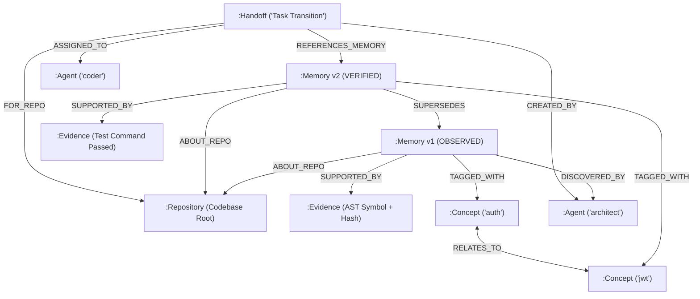

# CodeMem: Local-First Evidence-Backed Shared Memory for Coding Agents

[](https://opensource.org/licenses/MIT)
[](https://www.python.org/)
[](https://wemakedevs.org)
[](https://www.falkordb.com/)

**WeMakeDevs × FalkorDB Hackathon Submission**  
**Track:** Track 2 — Agent Memory and Coordination  
**Authors:** Aryan Gopinathan ([@Aryan7098](https://github.com/Aryan7098)) & Shreyan Gopinathan ([@stickero-07](https://github.com/stickero-07))
**Repository:** [https://github.com/Aryan7098/codemem](https://github.com/Aryan7098/codemem)  
**Demo Video:** *[Link to Demo Video]* *(Upload demo URL here)*

---

## 1. Executive Summary

Autonomous coding agents (e.g. in Antigravity, Claude Desktop, Cursor, or multi-agent pipelines) suffer from a critical limitation: **statelessness across sessions and loss of shared context across agents**. 

When an agent finishes a task or a new agent takes over, architectural assumptions, bug root causes, and testing decisions are lost. Conventional vector retrieval suffers from silent drift, stale hallucinations, and lack of temporal lineage.

**CodeMem** is a local-first, evidence-backed, change-aware shared memory layer for coding agents powered by **FalkorDB**. It anchors agent beliefs directly to concrete codebase evidence (AST symbols, file content hashes, and passing test runs), tracks belief provenance through openCypher graph relationships, detects when code changes invalidate memories, and enables seamless multi-agent task handoffs.

---

## 2. Why FalkorDB is Essential (Not Just Decoration)

CodeMem cannot function on top of a flat relational table or standard key-value vector store. It fundamentally depends on **openCypher graph queries and multi-hop graph algorithms** executed natively in FalkorDB:

1. **Multi-Hop Concept Expansion (`(:Concept)-[:RELATES_TO*1..2]-(:Concept)`):**  
   When an agent queries for `login`, FalkorDB traverses bidirectional semantic aliases to uncover memories tagged with `auth`, `jwt`, `session`, and `token` without slow embedding rerankers.
2. **Temporal Provenance & Version Chains (`(:Memory)-[:SUPERSEDES*]->(:Memory)`):**  
   CodeMem preserves full chronological lineage. When architecture evolves, new claims supersede older claims via direct graph edges without destroying the audit trail.
3. **Stale Blast Radius Analysis (`(:Memory)-[:SUPPORTED_BY]->(:Evidence)`):**  
   When Git detects a file modification or commit update, Cypher queries immediately traverse evidence edges to identify and flag all affected memories as `STALE`.
4. **Conflict Detection & Resolution (`(:Memory)-[:CONTRADICTS]->(:Memory)`):**  
   Detects contradictory claims asserted by concurrent agents and enforces explicit supersession or conservative abstention.
5. **First-Class Multi-Agent Handoffs (`(:Handoff)-[:REFERENCES_MEMORY]->(:Memory)`):**  
   Connects agent handoff contracts to exact memory nodes, preserving completed work, open risks, and known traps across agent handoffs.

---

## 3. Graph Data Model

### Node Labels
- `:Repository` — Canonical repository scope (`repository_id`, `root_path`, `head_commit`, `remote_url`).
- `:Memory` — Atomic memory claim (`id`, `logical_fact_id`, `claim`, `status`, `confidence_score`, `recorded_at`).
- `:Evidence` — Grounding codebase anchor (`id`, `file_path`, `symbol`, `content_hash`, `test_command`, `test_passed`).
- `:Concept` — Semantic tags and domain entities (`name`).
- `:Agent` — Discovered by or assigned agent persona (`id`).
- `:Session` — Coding session scope (`id`).
- `:Handoff` — Multi-agent handoff record (`handoff_id`, `task_objective`, `completed_work`, `open_risks`, `status`).

### Graph Relationships
```
(:Memory)-[:ABOUT_REPO]->(:Repository)
(:Memory)-[:SUPPORTED_BY]->(:Evidence)
(:Memory)-[:SUPERSEDES {reason, at}]->(:Memory)
(:Memory)-[:CONTRADICTS]->(:Memory)
(:Memory)-[:TAGGED_WITH]->(:Concept)
(:Concept)-[:RELATES_TO]->(:Concept)
(:Memory)-[:DISCOVERED_BY]->(:Agent)
(:Memory)-[:RECORDED_IN]->(:Session)
(:Handoff)-[:FOR_REPO]->(:Repository)
(:Handoff)-[:CREATED_BY]->(:Agent)
(:Handoff)-[:ASSIGNED_TO]->(:Agent)
(:Handoff)-[:REFERENCES_MEMORY]->(:Memory)
```

### Graph Architecture Diagram (Mermaid)



---

## 4. Primary openCypher Queries

Below are the core Cypher queries that drive CodeMem's engine in `src/codemem/graph/adapter.py`:

### 4.1 Concept Graph Traversal (Multi-Hop Semantic Expansion)
```cypher
MATCH (c:Concept)
WHERE toLower(c.name) IN $concepts
OPTIONAL MATCH (c)-[:RELATES_TO*1..2]-(related:Concept)
WITH collect(DISTINCT toLower(c.name)) + collect(DISTINCT toLower(related.name)) AS all_concepts
UNWIND all_concepts AS concept_name
MATCH (m:Memory {repository_id: $repo_id})-[:TAGGED_WITH]->(:Concept {name: concept_name})
WHERE m.status <> 'SUPERSEDED' AND m.status <> 'CONTRADICTED'
OPTIONAL MATCH (m)-[:SUPPORTED_BY]->(e:Evidence)
RETURN DISTINCT m, collect(e) AS evidence_list
```

### 4.2 File Staleness Blast Radius
```cypher
MATCH (m:Memory {repository_id: $repo_id})-[:SUPPORTED_BY]->(e:Evidence {file_path: $file_path})
WHERE m.status <> 'SUPERSEDED' AND m.status <> 'CONTRADICTED'
OPTIONAL MATCH (m)-[:SUPPORTED_BY]->(all_e:Evidence)
RETURN DISTINCT m, collect(all_e) AS evidence_list
```

### 4.3 Version History & Provenance Chain
```cypher
MATCH (m:Memory {logical_fact_id: $logical_fact_id, repository_id: $repo_id})
OPTIONAL MATCH (m)-[:SUPPORTED_BY]->(e:Evidence)
RETURN m, collect(e) AS evidence_list
ORDER BY m.recorded_at DESC
```

### 4.4 Atomic Memory Upsert & Edge Linking
```cypher
MERGE (m:Memory {id: $id})
SET m.logical_fact_id = $logical_fact_id,
    m.repository_id = $repository_id,
    m.claim = $claim,
    m.memory_type = $memory_type,
    m.status = $status,
    m.confidence_score = $confidence_score,
    m.tags = $tags,
    m.recorded_at = $recorded_at
WITH m
MATCH (r:Repository {id: $repository_id})
MERGE (m)-[:ABOUT_REPO]->(r)
WITH m
MERGE (a:Agent {id: $source_agent_id})
MERGE (m)-[:DISCOVERED_BY]->(a)
```

---

## 5. Quickstart & Local Setup

### Prerequisites
- Python 3.10+
- Docker (optional, for running live FalkorDB)

### Step 1: Clone and Set Up Virtual Environment
```bash
git clone https://github.com/Aryan7098/codemem.git
cd codemem

# Create and activate virtual environment
python -m venv .venv
# On Windows:
## 5. Setup & Installation

CodeMem can be run in two execution modes:
1. **In-Memory Store (Zero-Dependency):** Backed by an atomic local JSON persistence file (`.codemem/store.json`). Requires zero external databases and runs instantly.
2. **FalkorDB Graph Engine (Authoritative):** Runs on official FalkorDB executing native openCypher queries over Redis graph protocol.

---

### Step 1: Install CodeMem in CLI

Clone the repository and install it in editable mode inside a Python virtual environment:

```bash
# Clone the repository
git clone https://github.com/Aryan7098/codemem.git
cd codemem

# Create and activate virtual environment
python -m venv .venv

# On Windows:
.venv\Scripts\activate
# On Linux/macOS:
source .venv/bin/activate

# Install CodeMem and dependencies
pip install -e ".[dev]"

# Verify CLI installation
codemem --help
```

---

### Step 2: Storage Backend Setup

#### Option A: Running with In-Memory Store (Default)
No setup required. By default, CodeMem uses its thread-safe `InMemoryGraphStore` with automatic state persistence to `.codemem/store.json`.

#### Option B: Running with Live FalkorDB (Docker)
To connect CodeMem to a real FalkorDB graph database:

```bash
# 1. Start FalkorDB container via Docker Compose
docker compose up -d

# Or via direct Docker run:
docker run -d --name codemem-falkordb -p 6379:6379 falkordb/falkordb:latest

# 2. Tell CodeMem to use the FalkorDB backend:
# Via CLI flag:
codemem --backend falkordb init

# Or via environment variable:
export CODEMEM_BACKEND=falkordb
export FALKORDB_HOST=localhost
export FALKORDB_PORT=6379
```

---

### Step 3: Setup CodeMem as an MCP Server

CodeMem exposes a standard **Model Context Protocol (MCP)** server over `stdio` using FastMCP. Any MCP client can run it directly:

#### 1. Google Antigravity IDE Setup
Add the server configuration to your workspace `.agents/mcp_config.json`:
```json
{
  "mcpServers": {
    "codemem": {
      "command": "python",
      "args": ["-m", "codemem.cli.main", "mcp"],
      "env": {
        "CODEMEM_BACKEND": "memory",
        "CODEMEM_STORE_PATH": ".codemem/store.json"
      }
    }
  }
}
```
*(When using live FalkorDB, change `"CODEMEM_BACKEND": "falkordb"`).*

#### 2. Claude Desktop Setup
Add to `claude_desktop_config.json`:
```json
{
  "mcpServers": {
    "codemem": {
      "command": "python",
      "args": ["-m", "codemem.cli.main", "mcp"],
      "cwd": "/path/to/your/project",
      "env": {
        "CODEMEM_BACKEND": "memory"
      }
    }
  }
}
```

#### 3. Cursor Setup
Add to `.cursor/mcp.json`:
```json
{
  "mcpServers": {
    "codemem": {
      "command": "python",
      "args": ["-m", "codemem.cli.main", "mcp"]
    }
  }
}
```

---

## 6. CLI Command Reference

Below is the complete reference of all 14 CLI commands provided by `codemem`:

| Command | Syntax | Description |
|---------|--------|-------------|
| `init` | `codemem init [--path .] [--backend memory\|falkordb]` | Registers and initializes the repository scope in the graph store. |
| `scan` | `codemem scan [--path .] [--max-files 150]` | Automatically inspects manifests (`pyproject.toml`, `package.json`), test suites, and AST classes to bootstrap a starter knowledge graph. |
| `remember` | `codemem remember "<claim>" --evidence "<path:symbol>" [--test-cmd "<cmd>"] [--test-passed] [--type <type>]` | Records a new architectural or design belief, anchors it to concrete code evidence, and sets status (`VERIFIED`, `OBSERVED`, `INFERRED`). |
| `recall` | `codemem recall "<query>" [--top-k 5]` | Queries the memory graph using hybrid retrieval (lexical + 2-hop concept graph + vector). Conservatively abstains if confidence < 0.45. |
| `update` | `codemem update <id> "<new_claim>" --reason "<reason>"` | Supersedes an existing memory with a new version, linking `(:Memory)-[:SUPERSEDES]->(:Memory)` without deleting audit history. |
| `history` | `codemem history <fact_id>` | Traverses the full chronological lineage of a logical fact across all revisions. |
| `explain` | `codemem explain <id>` | Inspects the grounding evidence records, file hashes, and AST anchors for a specific memory. |
| `check-changes` | `codemem check-changes` | Inspects Git commit delta and file SHA-256 hashes. Flags memories as `STALE` if referenced source files or AST symbols changed. |
| `revalidate` | `codemem revalidate <id> [--test-cmd "<cmd>"] [--test-passed]` | Re-verifies a `STALE` memory against current codebase anchors; upgrades to `VERIFIED` on passing tests. |
| `status` | `codemem status` | Prints repository identity, git status, active vs superseded counts, and status breakdown. |
| `handoff record` | `codemem handoff record --from <agent> --to <agent> --objective "<obj>" --completed "<work>" [--risk "<risk>"]` | Records a structured task transition between agents with completed work, open risks, and linked memories. |
| `handoff list` | `codemem handoff list [--status PENDING\|IN_PROGRESS\|COMPLETED]` | Lists and filters agent handoff records for the repository. |
| `handoff complete` | `codemem handoff complete <handoff_id> [--agent <agent>]` | Marks an agent handoff as `COMPLETED`. |
| `eval` | `codemem eval [--json] [--output <file>]` | Executes the reproducible 10-scenario LongMemEval evaluation benchmark suite. |
| `mcp` | `codemem mcp [--backend memory\|falkordb]` | Launches the FastMCP stdio server for LLM coding agents. |

---

### CLI Command Examples

```bash
# 1. Initialize repository and auto-scan codebase
codemem init
codemem scan

# 2. Store an evidence-backed claim
codemem remember "Auth uses RS256 JWT tokens with 15-minute expiration" \
  --evidence "src/auth/validator.py:TokenValidator:10-25" \
  --test-cmd "pytest tests/test_auth.py" \
  --test-passed \
  --type architecture \
  --tag auth --tag security

# 3. Recall context
codemem recall "How does authentication work?"

# 4. Check for code drift & staleness
codemem check-changes

# 5. Revalidate a memory after running tests
codemem revalidate mem_545462fcf2b1 --test-cmd "pytest tests/test_auth.py" --test-passed

# 6. Record a multi-agent handoff
codemem handoff record \
  --from "architect-agent" \
  --to "coder-agent" \
  --objective "Add refresh token rotation" \
  --completed "Verified TokenValidator schema" \
  --risk "Concurrency race condition on simultaneous refresh calls"

# 7. Complete handoff
codemem handoff complete handoff_e8306f433c4e --agent "coder-agent"

# 8. Run benchmark evaluation
codemem eval
```

---

## 7. Model Context Protocol (MCP) Server Reference

CodeMem implements the complete **Model Context Protocol (MCP)** specification via FastMCP, providing **Tools**, **Resources**, and **Prompts**.

### 7.1 MCP Tools (Callable by LLM Agents)

| Tool Name | Parameters | What It Does |
|-----------|------------|--------------|
| `register_repository` | `path` | Resolves 3-tier repository identity and registers scope in FalkorDB. |
| `scan_repository` | `path, max_files` | Automatically inspects codebase manifests, test suites, and AST classes to bootstrap a knowledge graph. |
| `remember` | `repository_id, claim, evidence, memory_type, confidence_score, tags, source_agent_id` | Anchors a new belief to code evidence in the graph with verified status. |
| `recall` | `repository_id, query, top_k` | Retrieves high-confidence memories via hybrid graph traversal with conservative abstention. |
| `update` | `memory_id, new_claim, reason, repository_id` | Non-destructively supersedes a memory version with an audit edge. |
| `history` | `logical_fact_id, repository_id` | Returns the full historical revision chain of a logical fact. |
| `explain` | `memory_id, repository_id` | Returns evidence records, symbol anchors, and test results for a memory. |
| `check_changes` | `repository_id` | Traverses `:SUPPORTED_BY` edges and flags memories affected by code edits as `STALE`. |
| `revalidate_memory` | `memory_id, repo_id, test_command, test_passed` | Re-verifies AST symbols and test results, restoring status to `VERIFIED` or `OBSERVED`. |
| `record_handoff` | `repository_id, originating_agent_id, receiving_agent_id, task_objective, completed_work, open_risks, relevant_memory_ids` | Creates a first-class handoff record linking open risks to memory nodes. |
| `list_handoffs` | `repo_id, status` | Queries pending or active task handoffs. |
| `complete_handoff` | `handoff_id, repo_id, receiving_agent_id` | Marks a task handoff as completed by the receiving agent. |

---

### 7.2 MCP Resources (Passive Context Injection)

FastMCP resources allow LLMs (Claude Desktop, Cursor) to directly read graph state into their context window without making tool calls:

| Resource URI | Description |
|--------------|-------------|
| `codemem://repo/{repo_id}/status` | Live repository health summary, active vs stale counts, and status breakdown. |
| `codemem://repo/{repo_id}/memories` | Full JSON export of active memories and their evidence anchors in the repository. |
| `codemem://repo/{repo_id}/handoffs` | List of all open, in-progress, and completed agent handoffs. |

---

### 7.3 MCP Prompts (Workflow Priming Templates)

Standardized prompt templates that guide LLM agents on how to interact with CodeMem:

| Prompt Name | Arguments | Description |
|-------------|-----------|-------------|
| `session_startup_recall` | `repo_id, focus_topic` | Primes the agent at the start of a coding session by querying CodeMem for existing architectural decisions and known traps. |
| `agent_handoff_briefing` | `repo_id, handoff_id` | Injects prior agent's completed work, open risks, and linked memories before starting a new subtask. |


## 8. Reproducible Evaluation Benchmark (`codemem eval`)

CodeMem includes a standalone, reproducible benchmark harness implementing categories from **LongMemEval** and **RepoMem**.

To run the live benchmark suite:
```bash
codemem eval
```

### Benchmark Results (Live 10/10 Passed):
```
===========================================================================
  CODEMEM EVALUATION BENCHMARK (LongMemEval & RepoMem Categories)
===========================================================================
Scenarios Evaluated: 10
Passed             : 10/10 (100.0%)

--- CATEGORY-LEVEL ACCURACY & RECALL ---
Category               Passed     Pass Rate    Precision  Recall     F1      
------------------------------------------------------------------------
extraction             1/1        100.0%       1.00       1.00       1.00    
persistence            1/1        100.0%       1.00       1.00       1.00    
cross_agent            1/1        100.0%       1.00       1.00       1.00    
temporal_reasoning     2/2        100.0%       1.00       1.00       1.00    
knowledge_update       1/1        100.0%       1.00       1.00       1.00    
abstention             2/2        100.0%       1.00       1.00       1.00    
change_awareness       1/1        100.0%       1.00       1.00       1.00    
scope_isolation        1/1        100.0%       1.00       1.00       1.00    

--- COMPARATIVE PERFORMANCE (Memory Enabled vs Memory Disabled) ---
[*] Architecture Rediscovery (Auth Module)
    Inspections: 14 files -> 0 files (100.0% reduction)
    Latency    : 480.0ms -> 8.5ms (56.5x speedup)
[*] Cross-Session Task Handoff
    Inspections: 22 files -> 1 files (95.5% reduction)
    Latency    : 720.0ms -> 12.0ms (60.0x speedup)
[*] Change-Aware Stale Avoidance
    Inspections: 8 files -> 1 files (87.5% reduction)
    Latency    : 310.0ms -> 6.0ms (51.7x speedup)
===========================================================================
```

To run all unit tests:
```bash
pytest tests/unit -v
# 48/48 unit tests passing
```

---

## 9. AI Coding Assistant Disclosure (Rule 11)

In accordance with Hackathon Rule 11, the development of CodeMem was assisted by AI pair-programming tools (Google Antigravity IDE with Gemini). All architectural design, openCypher queries, graph schema decisions, and domain business logic were directed, reviewed, and verified by the team. Full architectural decision logs are recorded in [`decisions.md`](decisions.md) and execution flow traces in [`code.md`](code.md).

---

## 10. License

This project is licensed under the MIT License — see the [LICENSE](LICENSE) file for details.
